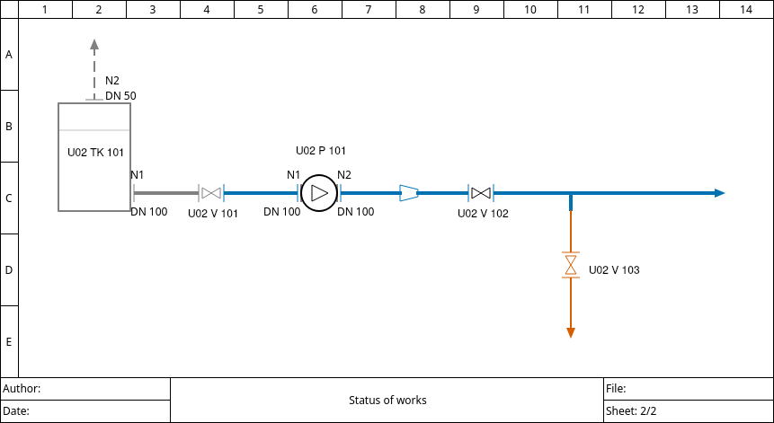
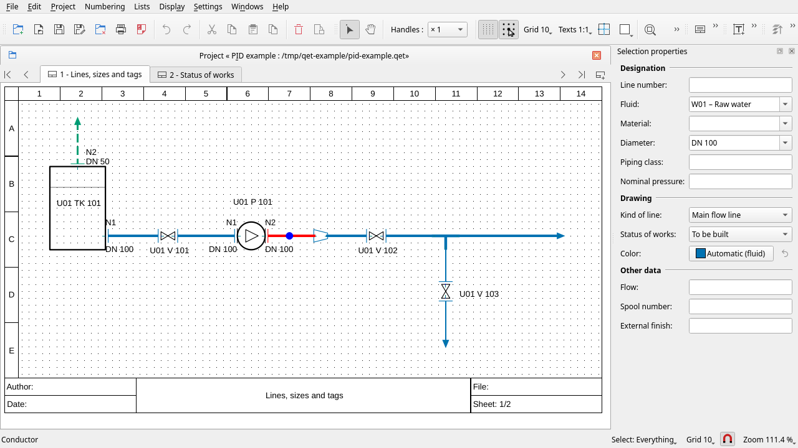
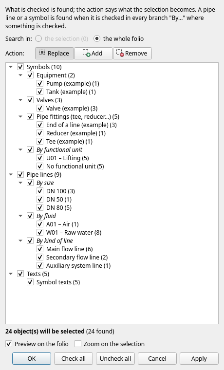

# QElectroTech for P&ID drawings (experimental fork)

This branch, `pipe-medium`, is a **personal and experimental fork** of
[QElectroTech](https://qelectrotech.org) that adds what is needed to draw
**P&IDs** (piping and instrumentation diagrams), for example for water
treatment plants.

**It is not official.** Nothing here has been reviewed or accepted by the
QElectroTech maintainers. The idea is discussed in
[Discussion #1475](https://github.com/qelectrotech/qelectrotech-source-mirror/discussions/1475).
This branch is a proof of concept; no pull request is proposed for now.

## The approach

Following the suggestion made in #1475, a pipe is **not a new kind of
object**: it is an ordinary QElectroTech conductor that carries a
**medium**. Terminals and conductors carry the same medium:

- `electrical` -- the default, not written in the files: every existing
  symbol and project is read and saved exactly as before;
- `pipe` -- the nozzles of process symbols and the pipes between them;
- `signal` -- the signal terminals of instruments and actuators and the
  signal lines between them.

There is no medium for a drive shaft: a motor is drawn in its symbol, and
a mechanical link would be a type of signal line.

So a pipe gets, for free, what a wire already has: drawing, routing,
selection, undo, copy and paste, saving in `.qet`, `.qetz` and `.qetdb`
files, the project database. What only makes sense for a wire is left out
of a pipe (see below).

The earlier attempt, with a separate pipe class, is kept frozen under the
tag `pipe-connector-freeze-2026-11-03`.

## A first look

The symbols of these pictures are simple shapes drawn for the example
only; the codes are invented.


*Lines colored after their fluid and drawn after their kind (main,
secondary, auxiliary), tags, names and sizes of the nozzles, flanges.*



*Status of works: existing and kept in grey, to be demolished in orange
(colors set for the project).*



*The page of a pipe: designation, drawing, other data.*


*The P&ID tab of a symbol: type and options, tag made of fields, nozzles.*



*Select by criteria: symbols by family, pipes by size, fluid, kind of
line.*

## What works today

**Terminals**
- A terminal of a symbol may connect the `pipe` or `signal`
  medium (attribute `medium` of `<terminal>` in the `.elmt`, written only
  when it is not electrical).
- Element editor: a *Medium* list in the terminal properties. The stem of a
  terminal takes the color of its medium; *Type* and *Potential* are
  hidden for a non-electrical terminal; its name follows its medium (N1,
  N2… for nozzles, S1… for signals).
- Joining two terminals of different media by hand is allowed but
  signalled (orange terminal, tooltip). A wiring rule, **off by default**,
  refuses it (*Refuse to join terminals of different media*, with the other
  conductors-per-terminal rules). Automatic wiring never joins two media.
- A nozzle takes **one** pipe: a branch is made with a tee symbol.
- **A junction** (a tee, a cross, an injection point, the tap of an
  instrument on a pipe: `pid_role` = `junction`) draws none of its lines. The folio draws one from the origin
  of the symbol to each nozzle, as the pipe of that nozzle: its width, its
  dashes, its colour. A nozzle without a pipe is drawn as the first pipe of
  the junction, else as a main line: a tee without its branch is printed
  too. The arrow head of an injection point, the only thing its symbol
  draws, takes the colour of the reagent line. In the collection, the
  thumbnail of a junction shows its lines.

**Pipes**
- Drawn by dragging from a nozzle, as a wire; released near a free nozzle
  of the same medium (20 pixels of the screen), the pipe is caught by it.
- **Draw a pipe** tool (key `P`, *Edit > Add*, the *Add* toolbar, the
  context menu of the folio): a click near a free nozzle starts a pipe, a
  second click or the release of a drag near another one ends it. A click
  never picks nor moves a symbol, the free nozzles are marked, the tool
  stays on after each pipe; right click or Esc cancels, then quits. The
  context menu of a symbol offers *Draw a pipe from here*: the pipe starts
  at its free nozzle nearest to the click. Lasso (Ctrl + drag) around two
  nozzles: one pipe between them.
- **From or to an empty place**: when the project names a symbol of free
  end (*P&ID* page, *Connections* tab), a click of the tool in an empty
  place starts or ends the pipe there, with that symbol at its end. The
  preview is the route the pipe will take; an end within 10° of an axis of
  the start is set on it (Ctrl: no snap), and Space switches between a
  route in L and in S when an end is free. From an empty place to an
  empty place, Space goes round four routes (an L along the longer way
  first, an L the other way, an S, an S the other way); the status bar
  names the one shown. A pipe started or ended on a
  free end takes that line up: one pipe, its route and data kept.
- **A tee placed by the tool**: when the project names a tee symbol, a
  click of the tool on a pipe, or a drag from a free nozzle released on
  it, places the tee there (on the grid, 2.5 mm at least from a nozzle),
  cuts that pipe and joins the branch, in one undo step. While the tool
  hovers a pipe, a circle shows where the tee will go, before the first
  click as while drawing.
- A conductor takes the medium
  of the terminal it starts from; other properties applied to it never
  change its medium. A file is read as it is: a conductor saved without a
  medium stays electrical.
- **No potential**: nothing goes from a pipe to the pipes or wires
  connected to it through the potential (numbering, shared properties,
  cables, bridges, search and replace…). What a line passes on has rules
  of its own (*Data that follow the line*, below).
- **No wire fields**: no wire number, no single-line symbols, definition
  mark, cable, wire color or section, voltage, bus or function.
- **Data of a pipe**: nominal diameter, fluid, material, flow, line
  number, piping class, nominal pressure, kind of line, spool, external
  finish, saved as `pid_…` attributes of the conductor, only those set.
  They go through `.qet`, `.qetz` and `.qetdb` files with no code of their
  own (checked by a round trip through a `.qetdb` file).
- **A page of its own** in the properties panel, and in the dialog a double
  click opens, in place of the page of a wire, in three sections
  (*Designation*, *Drawing*, *Other data*). Several pipes can be edited
  at once: only the field changed reaches them, in one undo step. The
  *Color* row tells where the color comes from (set by hand, status of
  works, automatic) and gives the automatic one back.
- **Data that follow the line**: a value set on the page of a pipe reaches
  its line in one undo step, and a message tells what was changed.
  Material, piping class and nominal pressure go through valves, tees and
  reducers, and stop at a **spec break** (a symbol of `pid_role` =
  `spec_break`) and at equipment. The fluid also goes through spec breaks;
  it stops at equipment and at a nozzle out of the run of a symbol (an
  injection point). The line number and the kind of line (main,
  secondary, auxiliary) go as the fluid, but through a tee or a cross only
  straight on, never into or out of the branch. The flow stops at every
  junction: a tee, a cross, an injection point. The insulation goes as the
  fluid, but stops at an insulation limit too. A new pipe takes what the
  line it joins has; the branch of a tee starts as a main line.
- **A codification per project**: *Project > Import a P&ID codification*
  reads the codes of the fluids and materials from a CSV file the company
  keeps (lines `kind;code;name;family`); none is shipped. The page of a pipe
  offers them ("W01 – Raw water"), a pipe keeps the code, free text stays
  possible; what is typed is looked for anywhere in the code and the name
  ("water" offers "W01 – Raw water"). Saved in a `<pid_codification>` block, written only when there
  is one, in `.qet`, `.qetz` and `.qetdb` files.
  It is also edited in the *Codification* tab of the *P&ID* page of the
  project properties: fluids, materials and functional units in tables, a
  line added or removed, a CSV file imported or exported (codes, then
  colors and texts, for another project). A name changed touches no pipe; a
  code changed reaches the pipes and symbols bearing it in the same undo
  step; a code removed stays on them as free text, after a question; a code
  is unique in its list. The codes are kept in their natural order (W2
  before W10).
- **Colors set for the project**, in a *P&ID* page of the project properties
  or imported from the same CSV file (`fluid_color;family;#rrggbb`,
  `object_color;pipe;#rrggbb`). A pipe takes the color set on it, else that
  of the family of its fluid, else that of the pipes; a symbol takes that
  of its family of objects (`pid_family` attribute of the `.elmt`: only its
  ink changes, not the white that masks). The code knows no color of its
  own, what has none stays black, and a folio drawn without colors stays
  black too.
- **Valves and instruments take the color of their line** (box of the
  *Colors* tab, ticked by default; `symbols_follow_pipes="false"` written
  only when unticked): a symbol of the `valve` or `instrument` family with
  a pipe on a nozzle takes the color of its pipes when they all agree,
  else (or with no pipe) that of its family; a status of works comes
  first. Equipment never does; tees and ends of lines already did.
- **Defaults for new projects**: two buttons of the *P&ID* page,
  *Save as default codification* (codes of the fluids, materials and
  functional units, sizes of the materials, equal DN) and *Save as default
  presentation* (colors, texts, connections drawn, models of tags), saved
  apart. A new project starts from both; projects that already exist do
  not change.
- **A status of works** on pipes, signal lines and P&ID symbols: to be
  built, the default,
  existing and kept, to be demolished. Its color, set for the project,
  comes before any other. Chosen on the page of the object, or for a whole
  selection in its context menu, in one undo step. On a symbol it is kept
  with the options, in `.qet`, `.qetz` and `.qetdb` files.
- **Drawn after its kind of line** (ISO 10628-1): main line 1 mm (4 units),
  secondary 0.5 mm (2 units), auxiliary 0.5 mm dashed. **The kinds are a
  list of the project** (*Lines* tab of the *P&ID* page): a code, a name,
  a width in mm and a pattern among solid, dashes, short dashes and
  dash-dot, with a preview and *Back to the values of ISO 10628-1*; the
  three kinds of ISO are always there, other kinds can be added (CSV line
  `line_kind;L4;Buried;0.7;dash_dot`). A kind removed stays on its pipes,
  drawn as a main line and named *(not in the project)*. The lines of tees
  and crosses follow the width set; the thumbnails of the collection keep
  the values of ISO.
- A P&ID symbol placed or moved on a pipe always cuts it, whatever the
  button of automatic break of conductors says (wires and signal lines
  follow the button); a tee takes the pipe through its run and keeps its
  branch free.
- **Magnet of the nozzles**: a symbol placed or dragged with the mouse is
  caught (20 pixels of the screen; Ctrl: no magnet) by a free nozzle
  facing one of its own, by the free end of a pipe, which it takes, or by
  a connected nozzle when its own nozzle lies on that pipe. Two nozzles
  that touch get no pipe between them. Ctrl places freely: no magnet, and
  no grid when moving (QElectroTech keeps its grid when placing).
- **Magnet of the line**: a symbol of the line (a valve, a check valve, a
  reducer, a limit, a spec break, a flow arrow; a tee or a cross by its
  run), placed or dragged alone near a straight segment of a pipe (the
  same distance), comes onto its axis, both nozzles on the pipe, and the
  segment is lit green; it turns a quarter by itself if the segment goes
  the other way, and takes back its own way when moved off. On the line,
  Space turns it end for end. The whole run must fit on the segment and
  both its nozzles be free; the magnet of the nozzles comes first, Ctrl
  stops both, and equipment is never caught.
- **Mirrored while placed**: after a double click in the collection, M
  mirrors a P&ID symbol left to right and F top to bottom, as the same
  keys do on a selection (the status bar says so); the symbol placed
  keeps it.
- **Deleting an in-line symbol** joins its two pipes into one again, with
  the data of the pipe on its N1 side; the branch of a deleted tee goes
  with it. A pump, a blower or any symbol with two nozzles only, face to
  face, is joined again the same way, though no change of size goes
  through it; a size that differs at the far end is then marked, as
  anywhere else. An equipment with more nozzles (a tank, a heat exchanger)
  leaves each of its pipes on the free end of the project, where its
  nozzle was, route and data kept (without a free end set, its pipes go
  with it). A pipe picked along with the symbol goes as asked. A free end
  left alone by a deletion is removed too. An end of a line (an arrow, a
  vent, an off-page connector, a battery limit) deleted alone leaves its
  pipe on the free end of the project. One undo step.
- A pipe is picked over its drawn width, a little more when hovered.
- **Crossings**: the hops of the project (off by default) may let the
  thinner of two crossing lines give way (`hop="thinner"`; the vertical
  one when they are as thick), with an arc or a gap of 1 mm
  (`shape="gap"`), for wires, pipes and signal lines alike. The marks of a
  signal line are moved off a crossing, and a dashed line is drawn solid
  on either side of a gap (ISO 128-20). The hops of QElectroTech are
  unchanged.
- **The route is kept**: a symbol dropped on a pipe or a signal line cuts
  it where it lies, each piece keeping the route it had; deleting the
  symbol joins them again on that route. Wires are routed as before.
- **Dragging a segment** of a pipe stops 7.5 mm from the nozzle it leaves
  (a message in the status bar says so), and a line folded back on itself
  is routed anew; a detour drawn by hand stays on its side when a symbol
  moves. Dragged towards a long end segment, the segment shortens it
  instead of running back over it (wires keep their short exits).
- **A line through a symbol is signalled**: the part of a pipe or a signal
  line that enters a symbol and leaves it again is painted orange, and its
  tool tip names the symbol. Its ends, where it meets its own nozzles, do
  not count. *Correct* > *Redraw the line* (context menu of the line, or
  of the symbol: *Redraw the N lines*) gives it back its default route,
  as *Reset conductors* does, offered only when that route crosses no
  symbol any more.
- **Insulation and heat tracing** (the *Insulation* row of the page of a
  pipe): none, insulation, heat tracing, or both, with a free text
  (`Q 80`) the designation writes by `{insulation}`, and a box *Hatched
  mark in the middle*. Chosen on a pipe, they go to the whole line, in
  one undo step: through valves, reducers, tees (branch included), spec
  breaks and flow arrows, up to an insulation limit or equipment; a
  message tells how many other pipes changed. A new pipe (a branch drawn
  from a tee) takes the insulation of its line, as its fluid. A short
  stub is drawn where the insulated part of the line begins and ends: at
  equipment, a free end, an insulation limit (from its line across the
  pipe), or a valve or tee beyond which the pipe is not insulated the same
  way; nothing at a valve or a tee between two pipes alike. Insulation:
  two lines either side of the pipe, hatched; heat tracing: a dashed line
  beside it, always on the same side of the sheet, below a horizontal pipe
  and right of a vertical one; both: the dashed line in the hatched band. The length of the stubs (8 mm) and their
  colours (none: that of the pipe) are settings of the project (*P&ID*
  page, *Colors* tab; CSV lines `text_option;insulation_stub;8`,
  `object_color;insulation;#rrggbb`, `object_color;tracing;#rrggbb`).
  The mark in the middle goes on the longest segment, after the
  designation as it reads, its text on the other side of the pipe. An
  insulation limit (a symbol of `pid_role` = `insulation_limit`, a short
  line across the pipe) cuts a line where its insulation stops; the data
  of the line go through it, each side keeps its own insulation. Deleted,
  it no longer stops it: the insulated side gives its insulation to the
  whole line joined again (that of its N1 side when both are insulated,
  and a message says so). On the
  screen, on paper and in a PDF. *Select by criteria* finds the pipes by
  insulation and by its text.
- **Double containment pipe** (the *Jacket* rows of the page of a pipe,
  step 8r-1): the pipe runs in a jacket, "PTFE 4x6 in PVC Ø 63". The
  jacket has a material of the project and a size picked in the series of
  that material (an outside diameter for a material named by it, its DN
  kept with it). It goes to the whole line as the insulation does, up to a
  jacket limit (`pid_role` = `jacket_limit`, two short lines across the
  pipe) or equipment; a new pipe takes it; *(None)* takes it away. Two
  lines either side of the pipe, 1.5 mm from its axis, with the pattern of
  its kind of line and half its width, are drawn where the jacket begins
  and ends, as long as the stubs of an insulation, or along the whole pipe
  (box *Jacket along the whole pipe*, this pipe only). Insulated too: the
  hatched band goes around the jacket, 3 mm from the axis, a heat tracing
  between them. Their colour: `object_color;jacket;#rrggbb` (*Colors*
  tab), that of the pipe without one, that of a status of works first.
  The designation writes `{jacket}` (code of the material and size,
  `M05 Ø 63`) and `{jacket_name}` (its name, `PVC Ø 63`); a word after a
  colon comes first, `{jacket_name:in}` gives `in PVC Ø 63`; nothing
  without a jacket. The page says a jacket which is not larger than its
  pipe. A deleted jacket limit, off-page connectors and *Select by
  criteria* treat the jacket as the insulation.
- **Flow arrow** (a symbol of `pid_role` = `flow_arrow`, an open chevron):
  placed on a pipe as a valve, it is a mark on the line; the pipe is drawn
  through it and nothing stops there.
- **Direction of flow, found from the symbols**, never typed nor saved: the
  nozzles of flow arrows, check valves, pumps (and compressors) and the
  arrows of arrival and departure say where the fluid comes in and goes
  out (`pid_flow_role`). The direction goes through valves, reducers and
  symbols that touch, and through a chamber of two nozzles of an equipment
  (a side of a heat exchanger, `pid_chamber`), never through a vessel; it
  stops at other equipment. At a tee or a cross: when all the other
  nozzles come in, the last one goes out, and the reverse. An arrow of both
  ways (`both`) is for a line used both ways in turn (a closed sand filter
  washed backwards). The page of the pipe and its tool tip tell it: *from
  PC-01 (N2) to VC-03 (N1)*, *both ways*, *unknown*, or *disagreement
  (FL-01, CV-02)*. Pipes only.
- **Disagreement**: when two sources of a line do not go the same way (an
  arrow against a check valve, a tee where everything comes in), each
  symbol in cause gets an orange disc of 4 mm at its centre, on the screen
  only, and its tool tip names the sources against it.
- **Reverse the direction of the line** (context menu of a pipe or of a
  flow arrow): the flow arrows of the line are mirrored at once, each on
  the axis of its pipes, in one undo step; check valves, pumps and the
  arrow of both ways are never turned, and the command is offered only
  when the arrows then agree with them. On a line in disagreement it goes
  into a **Correct** submenu, with *Align the arrows of the line on this
  one* and *Reverse this arrow* on a flow arrow. *Correct* holds the
  proposals for what is signalled: nothing is ever done unasked, one undo
  step each. It also corrects sizes and reducers (*Sizes*, below), a line
  through a symbol (above) and a line on a hidden terminal (*Symbols*).
- **Arrival and departure arrows** mark the limits of the drawing for the
  main fluids (raw water coming in, treated water going out): an arrow
  with a tail, pointing the way of the flow, the pipe leaving its point
  for an arrival, ending at its tail for a departure. They give the
  direction of their line, as a pump, and are never turned by *Reverse*
  or *Correct*. A text of origin or destination is written under the arrow
  (the *Comment* section, below). They are not folio references.
- **Off-page connectors of a pipe**: a line going on another folio ends on
  a folio report of QElectroTech (`next_report` / `previous_report`) whose
  terminal is a nozzle, drawn as a cartouche pointing the way of the flow,
  its text inside: the service (`%{comment}`), *to* or *from* and the tag
  on the other side (`%{notes}`, typed), and the place of its twin, written
  by the formula of folio references of the project (`(folio %f)` for a
  P&ID). They are linked, and jump to each other, as any folio report. A
  line coming from or going to another supply (the client, another lot)
  ends on a **battery limit** instead: the same cartouche, a plain symbol
  with no twin. Linking two of them asks nothing of the potential: a
  pipe has none.
- **Each side of an off-page connector keeps the data of its own pipe**;
  nothing goes through it. They are compared: when they differ (size,
  material, piping class, nominal pressure, fluid, line number, kind of
  line, insulation, flow, status of works; filled on one side and empty on
  the other counts), or when the connector has no twin, an orange veil
  covers its cartouche, on the screen only, and its tool tip says why. The
  pipe of the twin is read from the project database when its folio is not
  built: nothing is built to compare. A battery limit is never marked.
- **Copy from the other side** (context menu of an off-page connector in
  disagreement, *Correct*): the pipe of the connector, on this folio, takes
  the data of the other side which are filled there and differ here, each
  as far as when typed on the page of the pipe (the material up to a spec
  break, the size up to a reducer, the status on this pipe only), in one
  undo step; what is filled here is never emptied, and a size which is not
  one of the material of the pipe is not copied. The status bar tells what
  was copied. The folio of the twin is not built.
- **Select by criteria…** (*Edit* menu, context menu of the folio): a
  window that stays open beside the folio, with a tree of boxes: symbols
  by family, symbol, functional unit or status; pipes by size, fluid,
  material, line number, piping class…; signal lines by type of signal or
  status. A branch appears only when an
  object bears the data, and has a *No size*, *No fluid*… box: the pipes
  without a size are found there. The search runs in the selection or in
  the whole folio and replaces, extends or reduces the selection;
  rectangles drawn on the folio while the window is open follow the same
  action.
- **Words**: a pipe and a signal line are never called conductors. The
  status bar names what the mouse points at (`Pipe W01-L · DN 100`,
  `Signal line: Pneumatic`), the undo captions count pipes and signal
  lines apart, and the labels that stand for wires, pipes and signal
  lines together say *lines and conductors* (selection filter,
  *Display > Show*, contexts of the shortcut bar). A wire is called a
  conductor as before.

**Signal lines**
- A conductor drawn between two signal terminals is a **signal line**. It
  is not a pipe (no size, fluid nor material) and not a wire (no number, no
  potential, no wire fields), even when the signal is an electrical one.
- **Type of signal**: undefined (the default), pneumatic, electrical,
  hydraulic, capillary, guided electromagnetic, data link
  (`pid_signal_type`, written only when chosen). It stays on its line: it
  is never passed on to the lines connected to it.
- **Drawn after its type**: a thin line (0.25 mm, 1 unit) in the color the
  project gives the signal lines (`object_color;signal;#rrggbb`), with the
  mark of its type repeated every 12 mm along each straight run, read from
  the bottom or from the right. The catalogue of eleven marks is fixed in
  the code (plain line, dashes, one to three oblique bars, the letter-like
  marks of the pneumatic, electrical and hydraulic signals, cross, wave,
  circle). **Which mark each type takes is set for the project** (*Signal
  lines* tab of the *P&ID* page, CSV line `signal_mark;type;mark`); by
  default the mark ISO 14617 gives the type, else that of ANSI/ISA-5.1.
- **Drawn with the tool of the pipes** (key `P`): a click near a signal
  terminal starts a signal line, a click near a signal terminal of another
  symbol ends it, with the same magnet. `T` (Shift + `T` backwards) turns
  the type of signal of the lines drawn; the preview shows its mark. The
  context menu of a symbol offers *Draw a signal line from here*. But for
  a process connection (below), a signal line ends at a signal terminal,
  and a signal terminal takes several lines (that of a closure, one).
- **Process connection** (the line from the process to an instrument
  bubble), drawn in one gesture with the same tool: from a signal terminal
  while the type is *Process connection*, to a free nozzle or a free end;
  or from a free nozzle or a free end to a signal terminal, whatever the
  type. On a free nozzle (equipment, valve, tee...) the line ends on the
  nozzle itself, which takes no pipe any more. A free end (the line ends on
  nothing) is closed by the **blind flange** set for the project (*P&ID*
  page, *Connections*, CSV line `tool_symbol;blind_flange;…`), placed where
  the free end was, and the line leaves from its signal terminal; the
  status bar says so when the line did not end with a flange. A blind
  flange placed this way goes with the pipe it closes; one placed by hand
  stays. One undo step.
- **Closures** (blind flange, dished end, cap: `pid_role="closure"`): the
  signal terminal of a closure takes one line, a process connection,
  whatever the type the tool draws or a drag gives; another type is
  refused there. A closure deleted alone leaves its line open again: the
  free end of the project where it was, the pipe and its data kept, its
  process connection gone with it (without a free end set, the pipe goes
  too, as before).
- **An end of a line turns by itself**: a symbol of the pipe family with
  one free nozzle (free end, arrow, vent, closure...) dropped or moved
  with its nozzle on a free end turns the same way and takes the line on;
  on a free nozzle of another symbol, it turns to face it, the two
  touching. Another symbol facing away from a free end is only placed:
  the line is never lost.
- **A page of its own** in the properties panel, and in the dialog a double
  click opens: type of signal and status of works, for one signal line or
  several, in one undo step.
- **Status of works** as on a pipe (`pid_status`): its color comes before
  that of the signal lines.
- A tee is never placed on a signal line: the tool says why.

**Sizes: the size lives on the pipe**
- The way of working: draw, connect, place the fittings, **size at the
  end**. The size belongs to the pipe; the valves and fittings on it follow.
- The **DN is the size of the line**, on every pipe (`pid_dn`). A material
  named by its outside diameter, as a plastic, also gives the pipe its
  outside diameter to the tenth (`pid_od`, Ø 110, Ø 88,9); the material
  chooses what is written on the drawing. Files always write a point; the
  project chooses the decimal separator shown (*P&ID* page, *Texts* tab),
  whatever the computer.
- Each material of the codification has its **list of sizes** (*Materials*
  tab, CSV line `size;M04;125;100`): an outside diameter and the DN of the
  flange it fits for a plastic, a DN (and an outside diameter if wanted)
  for a metal. When a DN has several outside diameters, one may be the
  default. **Equal DN** are set for the project (`dn_equal;60;65`): a cast
  iron DN 60 and a steel DN 65 are the same size; without a material, such
  a size is written `DN 60/65`.
- The page of a pipe has one size field: a DN or an outside diameter is
  typed, the other is found in the list of its material, with a question
  when there are several (its answer can be kept as the default). When the
  material changes, the DN is kept and the outside diameter found again. A
  size out of the list of its material is marked by an orange band under
  the pipe, on screen only.
- **Inline symbols have no size of their own**: the nozzles of a valve
  (`pid_inline`, its two nozzles) or of a tee (`pid_run="N1 N2 N3"`)
  follow their pipe; their size field is greyed, in
  the *Nozzles* section of the *P&ID* tab as in the element editor. A
  change made on the page of a pipe goes through them, and through
  nozzles that touch with no pipe between them, in one undo step, each
  material taking it as it has it (DN 60 for a cast iron). It stops at
  equipment and at reducers.
- **The branch of a tee has a size of its own**: the size goes through a
  tee or a cross straight on only, as the line number. A reducing tee is
  one tee, DN 25 on a DN 50 line, with no reducer and no mark; a change of
  DN on the line leaves its branches as they are. A pipe drawn from the
  branch starts with the size of the line (an equal tee until told
  otherwise), unless the nozzle at its other end has a size.
- Equipment, instruments and **reducers** have sizes of their own: given in
  the symbol (the element editor chooses DN or Ø beside the field) and
  changed on a placed symbol in the *Nozzles* section of its *P&ID* tab
  (`<pid_nozzles>` block of `<element>`, written only when set; undoable).
  A reducer (`pid_role` = `reducer`) is where the size of the line
  changes: a size typed on one of its sides resizes that line in the same
  undo step. A `.qetdb` file keeps a size given on a placed symbol, as
  it keeps the options.
- A size fills what is empty and never replaces a value: a new pipe
  without a size takes that of its nozzle, once. A size typed on a nozzle
  of an equipment, or brought by *Change type*, fills the pipes without a
  size of its line, up to a reducer, an equipment or a sized pipe, in one
  undo step.
- A difference is marked without being blocked: an orange diamond in front
  of the pipe, on screen only, and a tooltip (a reducer with the same size
  on both sides too). No reducer is ever inserted unasked.
- **Correct a size** (context menu of the pipe or of the symbol, *Correct*,
  one undo step each): on a nozzle with a size of its own, *Give DN 80 to
  the line* (as far as when typed on the page of the pipe; not offered
  when the size is not one of the material of the line) and *Give DN 100
  to the nozzle N1*; on a valve between two sizes, or under an orange band
  of a size out of the series, *Change the line to DN …* for the two sizes
  around it. The end nearest the click is the one corrected.
- **Insert a reducer here** (*Correct*, on a diamond between exactly two
  sizes): when the project names a reducer symbol (*Connections* tab,
  CSV line `tool_symbol;reducer;…`), it is placed 10 mm from the nozzle
  (nearer, down to one step of the grid, on a short segment), its large
  side towards the large size (mirrored if needed), the pipe cut, route
  and data kept, in one undo step. Without such a symbol, no entry.
- A reducer may name its large side (`pid_large`, *Large side* list of the
  element editor): laid the wrong way, its two nozzles are marked and the
  tooltip says so; nothing is turned nor blocked unasked: *Correct* >
  *Reverse the reducer* mirrors it on the axis of its pipes, which go over
  to the nozzle in front, its own sizes swapped, in one undo step.
- **A reducer writes its two sizes** where its label goes, when it has no
  label of its own: `100 × 80`, `Ø 125 × 110` (the sign once), `Ø 110 ×
  DN 80` when they differ, in the order of the drawing (left first, or
  the way the vertical texts read), kept up to date; nothing while a side
  has no size. On screen and on paper only: the file keeps an empty label,
  and a label typed takes its place. Box *Write the sizes of the reducers*
  of the *Texts* tab, ticked by default (`reducer_sizes="false"` written
  only when unticked; CSV line `text_option;reducer_sizes;false`); their
  size is that of the fittings (CSV line `text_size;pipe;…`).
- The size of a nozzle is shown with its name, when terminal names are
  shown and the project shows the sizes; the word `DN` can be left out
  (*Texts* tab). Both are written 1 mm from the end of the nozzle, along its
  pipe and clear of the mark of its connection: the name above and the
  size below a horizontal pipe, their letters 3 mm from its axis; beside
  a vertical one, upright or turned
  as the project keeps the texts of rotated elements horizontal or not.
  Turned, they read as the texts of the symbol: from the bottom, or from
  the top on a symbol turned a quarter clockwise unless the vertical texts
  of the symbols read from the bottom (setting of the computer, or of the
  project: see the labels).

**Connections of the nozzles**
- Each nozzle has a kind of connection: flange (the default, not written),
  plain end, socket (to glue, to weld or with a gasket: the material of the
  pipe tells them apart), pipe thread, butt weld, grooved or quick coupling
  (`pid_connection` attribute of `<terminal>` in the
  `.elmt`, changed on a placed symbol in the *Nozzles* section of its
  *P&ID* tab, in the same undo step as its size). The list is fixed in the
  code.
- In that section the nozzles are listed by name (N10 after N9), and a
  chain button above each column (connection, size, drawing of the
  connection) keeps the nozzles of the symbol alike: the first one gives
  its value. A link is undone only by a click, and stays
  undone (`same_connection`, `same_size`, `same_mark` = `false` on
  `<pid_nozzles>`).
- The connection limits the kind of size: a flange or a quick coupling
  takes a DN, a pipe thread inches, the others a DN or an outside diameter.
  When the connection changes, a size it allows is kept, else it is
  converted when there is one answer, else it is removed and said.
- A pipe thread is sized in inches (`pid_thread="1 1/2"`), shown `G 1"1/2`,
  and typed as `G 1"1/2`, `1"1/2`, `3/4"` or `1-1/2`. A fixed table (the
  usual one of EN 10255, 1/8" = DN 6 to 6" = DN 150, shown in two rows,
  *Thread* and *DN*, in the *Connections* tab of the *P&ID* page) joins
  inches to DN:
  for the orange diamond, and for a new pipe, which takes the DN of its
  threaded nozzle (a pipe is never sized in inches).
- The folio shows the size (`DN 100`, `Ø 110`, `G 1"1/2`) and draws the
  connection at the end of the nozzle (flange, socket…), for the kinds of
  connections and the families of symbols the project chooses
  (*Connections* tab); the connection is also named in the tooltip of the
  nozzle.
- How it is drawn: a flange is a line across the pipe, 1 mm from the side
  of a valve or at the end of the nozzle of an equipment. The pipe brings
  its own part, in its own color: its flange 1 mm further (the
  counter-flange), its socket around a plain end (drawn with the
  sockets), its grooved end in the collar, the other half of a quick
  coupling. A butt weld is a dot. Two symbols joined nozzle to nozzle
  draw nothing between them. A spec break is transparent: the pipe draws
  the part that answers the symbol on the other side. A pipe begins at
  its nozzle: the square end of a thick line never shows behind it, in
  the symbol. The element editor draws the mark of the connection chosen
  on the nozzle, in the colour of the nozzle.

**Symbols**
- **A *P&ID* tab** in the properties panel of a placed P&ID symbol, first
  and open by default, in sections: *Type and options*, *Tag*, *Nozzles*,
  each shown when it applies. An electrical symbol has no such tab.
- **Change type**: right-click a placed symbol, *Change type* lists the
  symbols of the same collection folder that have the same size, hotspot
  and terminals (name, place, direction and medium: two terminals may
  share a place when they face apart), and through which the lines go
  the same way: the same run, a reducer for a reducer, a spec break for a
  spec break, a closure for a closure. A tee, whose branch is of the line, is never offered for an
  injection point, whose reagent is not. The symbol is swapped in place,
  keeping its position, information and connections; undoable. A generic
  symbol (a valve, a pump) can be placed first and made precise later. A
  P&ID symbol keeps its texts (its tag) and takes the identifier of the new
  symbol. The *Type* list of the *P&ID* tab does the same; both show a
  thumbnail of each symbol.
- **Symbols that play a role for the lines** (`pid_role`, chosen in the
  *Piping* block of the element editor, with the family, the run and the
  large side): a reducer, a free end, a spec break, a junction, a closure
  (blind flange, dished end, cap: its signal terminal takes the process
  connection). Any symbol of the `pipe` family with one nozzle takes the
  free end of a line and follows its size.
- **Tags made of fields**: a P&ID symbol may give the identifier of its
  type (`prefix` attribute of `<definition>`, e.g. `PC`). A placed
  equipment or valve has a *Tag* section in its *P&ID* tab: functional
  unit (picked in the list of the project, or typed: "lift" offers
  "U01 – Lifting", what is typed being looked for anywhere in the code and
  the name, as for the letters of an instrument), train and order,
  saved as information of the element. The model of its family in the
  project, for instance `{unit} {id} {train}{order:2}`, makes its label
  (`U01 PC 105`); `\n`
  starts a new line. The label
  follows a change of model or of type, and a label held twice in the
  project is told. Without a model, the label is typed by hand as before.
  The label of a turned symbol follows the project: when it keeps the
  texts of rotated elements horizontal, the label stays level, beside an
  upright line rather than across it (its near edge as far from the line
  as under the symbol upright), its middle on its place when the symbol
  is turned half a turn; else it turns with the symbol. It is never upside
  down, and reads from the bottom if the vertical texts of the symbols do:
  a setting of each computer, which the *Texts* tab of the *P&ID* page may
  set for the project instead, so that it looks the same everywhere (*Read
  from the bottom* or *Read as the symbol is turned*; `vertical_texts` in
  the block, CSV line `text_option;vertical_texts;from_bottom`). The file
  is the same either way.
  The functional units come with the codification of the project (CSV line
  `unit;U01;Lifting`), the models with its presentation (CSV line
  `tag_model;equipment;...`) or are typed in the *Models* section of the
  *Texts* tab of the *P&ID* page, where *Insert a field* lists the fields
  of each family and an example shows what the model makes.
- **Letters of an instrument**: an instrument bubble may be any instrument,
  so its *Tag* section asks its letters of identification (`PT`, `LIC`),
  typed in capitals, instead of the identifier of its symbol; they take the
  place of `{id}` in the model. The letters the project uses are offered
  while they are typed: a list of the codification, *Instrument letters*
  (CSV line `letters;PT;Pressure transmitter`), a help only.
  The bubble writes its tag in two texts, as ANSI/ISA-5.1 (annex B.3.1)
  does: the letters in its upper half, the rest of the tag (the model
  without `{id}`) in its lower half. `U01 LIT 102` stays one label, in the
  order of the bill of materials, and is drawn `LIT` above `U01 102`.
  Two information a text field can show, never saved, do it (*Tag,
  identifier (letters)* and *Tag, without its identifier*); without a
  model, the first line of the label typed by hand goes above. Both texts
  are parts of the label: they take its colour and the size of its
  category.
  Turned or mirrored, a bubble turns its two texts with it, even in a
  project keeping the texts of rotated elements horizontal (no level place
  fits in a turned oval): never upside down, read from the bottom when the
  vertical texts are, the letters always first. Draw its signal lines from the
  terminal on the side wanted instead.
- **Tags numbered automatically**: the order is one more than the highest
  held by the same functional unit, identifier and train in the project
  (a number freed below it is not given again; no counter is saved, the
  project is read each time). The *Tag* section fills an empty order as soon
  as the unit is there, and *Next number* gives it on demand; an order
  typed is never changed. When the model shows the train, a numbered tag
  always has one (0 for none). A pasted copy whose tag is taken gets the
  next order (a cut and paste keeps its own).
  Instruments are numbered by loop, as ANSI/ISA-5.1 (annex A) does: in
  series by default, one sequence for all of them whatever their letters
  (PT 105 and PIC 105 are the loop 105); in parallel when the presentation
  says so (`tag_option;instrument_numbering;parallel`), one sequence for
  each measured variable, their first letter. A loop copied whole gets one
  new number. Equipment and valves keep a sequence of their own.
- **Line designation**: the model of the lines in the presentation of the
  project (CSV line `tag_model;line;{fluid} {size} {material}`, or the
  *Models* section of the *Texts* tab) puts the
  data of a pipe together: `{fluid}`, `{line_number}`, `{material}`,
  `{piping_class}`, `{pn}`, `{flow}`, `{size}` as drawn (`DN 100`,
  `Ø 110`, `DN ?` when it has none) and `{dn}`, the number alone;
  `{fluid_name}` and `{material_name}` write the names the codification
  gives the codes (the code when it has none). A pipe
  shows it when *Show the designation on the folio* is ticked in its page
  (none by default): above a horizontal pipe, on the left of a vertical one
  read from the bottom, in the middle of its longest segment; it can be
  moved by hand, not typed, and follows any change of the data or of the
  model. It is saved as the text of the conductor. Its size is set in the
  *Texts* tab (*Designations of the lines*). A symbol dropped on the pipe
  leaves it written once: on the longest piece, or where it was if it was
  moved.
- **Colour of the labels and of the designations**: two rows of the
  *Texts* tab, each with the colour of its object (the symbol, the pipe)
  or a fixed colour, black by default (`label_ink` and `designation_ink`
  in the block, `object` or a colour, written only when not the default;
  CSV lines `text_option;label_ink;object`). The former `colored_labels`
  is read for both. A folio drawn in black keeps black labels.
- **Texts moved away from their line** (wires and pipes alike): the main
  page of the project properties may tie a text moved by hand further
  than a distance (5 mm proposed) to its line by a thin leader line of
  its colour, drawn to where the text stands unmoved (the middle of the
  longest segment), with a plain end or an arrow (both stopped 0.5 mm
  short of the line) or a dot (`<text_leaders
  distance="5" end="dot"/>`, written only when on: none by default, a
  dot being a junction on an electrical diagram). *Put the texts back in
  their place* (context menu) gives the texts of the selected
  lines the place their line gives them, path left as it is; undoable.
  A Ctrl+click on the text of a line adds it to the selection, or takes
  it out, as on the other texts (a Ctrl+drag still places it off the
  grid).
- **A *Comment* section** in the *P&ID* tab of a symbol which shows its
  comment (an arrow of arrival or departure, an off-page connector): a
  field of several lines (Enter starts a new line, Tab goes on), applied
  when it is left, the same as *Comment* in the *Information* tab; an
  off-page connector adds *Tag on the other side*. One undo step. QElectroTech
  now replaces `%{notes}` and the other fields added lately to the
  information of an element in a composed text. *Change type* adds to
  the symbol the texts of the new one it lacks.
- **Thumbnails**: in the collection, the thumbnail of a P&ID symbol is
  square and framed on its drawing; the ends of a line show a short pipe
  at their nozzle, which tells an arrival from a departure.
- The entries the fork adds to the context menu have icons, following the
  rules of QElectroTech (`ico/README.md`).
- **Create similar**: right-click a placed symbol, *Create similar* starts
  the usual placement mode with the same symbol, options, status of works
  and rotation. Device information is not copied; a P&ID tag takes the
  same functional unit and train, and the next order at each drop.
  Automatic connections apply as usual.
- **Mirror**: a P&ID symbol (one with a nozzle or a signal terminal) is
  mirrored on its folio about its hotspot, on the axis of its line, as it
  is rotated: a valve with a handwheel turned upside down stays on its
  line and its pipes stay straight. An electrical symbol keeps its centre
  where it was, as before.
- **Pipes follow a turned or mirrored symbol**: a valve, a flow arrow, the
  run of a tee or a cross, or a symbol with two nozzles only face to face
  (a pump), mirrored or turned by a half (two quarter turns), would leave
  its pipes running back through it: in each pair of opposite nozzles,
  the pipes go over to the other nozzles when fewer of them then run back
  through the symbol, in the same undo step; as many either way, they
  stay (a valve at the top of a U turned by a quarter). The route drawn
  is kept when the new nozzle stands where the first one stood. A quarter
  turn of a straight line changes nothing; a line in L that now leaves
  behind the symbol is taken by the other nozzle. The
  branch of a tee keeps its pipe, even when it then runs back through the
  tee, as does any nozzle of an equipment with more than two; a pair drawn
  the wrong way round before the turn, or a pipe which turns with both its
  ends, stays. Pipes only: wires and signal lines stay where they are.
- **Ends and corners of lines**: the element editor can draw the ends of a
  line round or flat and its corners round, mitred or bevelled (`line-cap`
  and `line-join` in the style of a part; nothing written for the default).
- **Symbols with options**: a symbol may declare options (an `<options>`
  block, each option with named values and a default) and draw some parts
  only for some values (`show_if` attribute). Example: one pump symbol
  with a *motor* option (none, fixed speed, variable speed) instead of
  three symbols. Conditions separated by ";" must all hold; lists of them
  separated by "|" are alternatives (`show_if="command=motor|limit_switches=true"`:
  the signal terminal of a valve, shown with an automatic actuator or with
  limit switches). The element editor shows such a symbol case by case: its
  bar *Options preview* has a list of the values of each option, and
  hides the parts of the other cases (only on screen; the file keeps
  them all). A terminal may depend on the options too: the signal
  terminal of a valve is shown, and takes a signal line, for an automatic
  actuator only; it stays a terminal of the symbol (*Change type* keeps
  it), and a line already connected to it stays, unless the terminal
  shown in its place replaces it (`replaces` attribute of `<terminal>`,
  either way): the line then moves to that one, routed as when the symbol
  moves, in the same undo step (an oval bubble takes the lines of the
  round one), never when a file is opened. A hidden terminal a line still
  holds is marked, not blocked: an orange stem with an orange disc of
  3 mm, on the screen only, and a line in its tool tip. *Correct*, on the
  symbol or on that line, offers *Set Actuator to Motor* (one entry per
  value of a single option which shows the terminal again without hiding
  another one that holds a line) and *Delete the line of the hidden
  terminal*.
  A placed symbol saves its choices in its `<element>`
  block, only when it has some; they are chosen in the *Type and options*
  section of its *P&ID* tab or in the *Options* submenu of its context
  menu (undoable) and kept by *Change type*. A `.qetdb` file
  keeps them too (rows of the project database, see below). A project may give an option of a family of P&ID symbols
  a value of its own (the oval bubbles of a plant: *instrument*, *shape*,
  *oval*), in the *Symbols* tab of its *P&ID* page or from a placed symbol
  (*Options*, *Make these choices the defaults of the project*): a symbol
  placed new from the collection or by a tool takes it, written in its own
  choices, so that a symbol placed before, a copy and *Change type* keep
  theirs.

**Scale and paper sizes**
- P&ID drawings use 4 drawing units per millimetre, close to the 3.78 of
  the PDF export. Choose the paper size in the *Format* list of the folio
  properties (A0 to A3 suit a P&ID): widths and symbols come out at about
  106 % of their nominal size, and a P&ID is not drawn to scale anyway. The
  default of a new folio is set in the project properties, *New sheet*.
- The *P&ID* page of the project properties sets the size of the tags of
  equipment, valves, instruments and fittings (*Labels of fittings*, the
  `pipe` family: reducers, tees...), of the names and diameters of the
  nozzles (none set: the size of the symbol) and of the line designations, and whether those of the
  nozzles are printed and exported.

**Windows of settings** (not P&ID only)
- In *Project properties* and *Configure QElectroTech*, each page scrolls
  by itself, the list on the left staying still: a short page no longer
  scrolls because a long one is in the same window. The tabs of *General*,
  *New project* / *New folio* and of the *P&ID* page scroll each on its
  own, the buttons under them always in sight. The icons of the list are
  48 pixels.
- *Ask for a backup copy when a project is opened* (*Configure
  QElectroTech*, *General*, *Projects* tab, ticked by default): the
  question asked at each opening can be turned off, there or by its box
  *Do not ask again*. The progress window no longer stays behind it.

**Checks**: every step has its tests, and the example projects of
QElectroTech are saved byte for byte as by master.

## What is missing

- The direction of flow as data (a property of the line, checked against
  the symbols); the kind of a heat tracing (electrical, steam...).
- Off-page connectors of signal lines; the tag on the other side found by
  itself; *Copy to the other side*.
- A signal line ending in an empty place, or taken from a pipe where it
  has no symbol (an instrument tap, a junction, is placed on the pipe for
  now); equipment data tables.
- Piping classes (material, pressure, wall thickness), the pressure rating
  (PN) of the nozzles.
- Equipment drawn to size (a tank that stretches).
- Keeping the tags of an issued drawing set: once issued, a deleted tag
  should never be given again.
- Declaring options and conditions in the element editor (they are written
  by hand or by script for now, and kept by the editor).
- A library of P&ID symbols (symbols are drawn *inspired by* ISO 10628-2,
  never copied from it; none is published here).

## What the files carry

Every P&ID addition is written only when it is set, so a file without one
is saved as by master. A name added for the P&ID starts with `pid_`; what
is inside a `pid_` block keeps short names. `medium` keeps its name, and
the additions that are not P&ID-only keep plain names (`prefix`,
`<options>`, `show_if`, `replaces`, `line-cap` / `line-join`,
`<text_leaders>`, the `thinner` and `gap` of `<wire_crossings>`). Booleans are `true` /
`false`.

| Where | Name | Values | Default | Written when |
|---|---|---|---|---|
| `.elmt`, `<definition>` | `pid_family` | `equipment`, `valve`, `instrument`, `pipe` | none: not a P&ID symbol | the symbol has a family |
| `.elmt`, `<definition>` | `pid_inline` | `true` | a line does not run through it | a line runs through its two nozzles (valve) |
| `.elmt`, `<definition>` | `pid_run` | names of nozzles, space separated (`N1 N2 N3`) | the two nozzles of a `pid_inline` symbol | a tee or a three-way valve |
| `.elmt`, `<definition>` | `pid_role` | `reducer`, `free_end`, `spec_break`, `junction`, `closure`, `insulation_limit`, `jacket_limit`, `flow_arrow` | none | the symbol plays that role for the lines |
| `.elmt`, `<definition>` | `pid_large` | name of a nozzle (`N1`) | none: the way of the reducer is not checked | a reducer names its large side; a large side smaller than the other one is marked |
| `.elmt`, `<definition>` | `prefix` | identifier of the tag (`PC`) | that of the collection folder | the symbol gives one |
| `.elmt`, `<definition>` | `<options>` block | options, each with named values and a default | no option | the symbol declares options |
| `.elmt`, a part | `show_if` | `option=value,value`, conditions separated by `;` | always drawn | the part belongs to some values |
| `.elmt`, a part | `line-cap`, `line-join` in `style` | `round`, `flat` / `miter`, `round`, `bevel` | square ends, default corners | not the default |
| `.elmt`, `<dynamic_text>` | `<info_name>` `pid_tag_id`, `pid_tag_rest` | the identifier of the tag; the tag without it (read when drawn, never saved) | — | a text of the symbol shows a part of its tag (instrument bubble) |
| `.elmt`, `<terminal>` | `medium` | `pipe`, `signal` | `electrical` | not electrical |
| `.elmt`, `<terminal>` | `show_if` | as for a part | always shown, takes lines | the terminal belongs to some values |
| `.elmt`, `<terminal>` | `replaces` | name of another terminal of the symbol (`S3`) | none: a line stays on its terminal | an option shows this terminal and hides that one, or the reverse: the lines move to the terminal shown |
| `.elmt`, `<terminal>` | `pid_dn`, `pid_od`, `pid_thread` | DN; outside diameter to the tenth; inches (`1 1/2`) | the size of its pipe | a nozzle with a size of its own |
| `.elmt`, `<terminal>` | `pid_connection` | `plain_end`, `socket`, `thread`, `butt_weld`, `grooved`, `quick_coupling` | `flange` | not a flange |
| `.elmt`, `<terminal>` | `pid_flow_role` | `in`, `out`, `both` | none: the flow goes through the nozzle either way | the fluid comes in or goes out there (check valve, pump, flow arrow), or goes both ways in turn (`both`, the arrow of both ways); the direction of flow of the pipes is found from it, never written |
| `.elmt`, `<terminal>` | `pid_chamber` | a name (`1`, `2`) | none | the nozzle belongs to that chamber of its equipment (a side of a heat exchanger); the direction of flow goes through a chamber of two nozzles, never through one of three or more (a vessel) |
| `.qet`, `<element>` | `<options>` block | `<option name="…" value="…"/>`, among them `pid_status` (`existing`, `demolished`) | the default of each option; to be built | a value is chosen |
| `.qet`, `<element>` | `<pid_nozzles>` block | `<nozzle name dn od thread connection mark/>`, `mark` = `always`, `never`; on the block, `same_connection`, `same_size`, `same_mark` = `false` | those of the symbol and the project; nozzles linked | a nozzle of the placed symbol is changed, or a link undone |
| `.qet`, `<element>` | information `pid_unit`, `pid_train`, `pid_order` | text | empty | the *Tag* section is filled |
| `.qet`, `<element>` | information `pid_letters` | letters of identification of an instrument (`PT`) | the identifier of its symbol | the letters of an instrument are typed |
| `.qet`, `<element>` | `pid_tool_placed` | `true` | `false`: placed by the user | a blind flange the pipe tool placed on a free end; it goes with the pipe it closes |
| `.qet`, `<conductor>` | `medium` | `pipe`, `signal` | `electrical` | not electrical |
| `.qet`, `<conductor>` | `pid_dn`, `pid_od` | DN; outside diameter to the tenth | none | set |
| `.qet`, `<conductor>` | `pid_fluid`, `pid_material`, `pid_flow`, `pid_line_number`, `pid_piping_class`, `pid_nominal_pressure`, `pid_spool`, `pid_external_finish` | text (a code of the codification, or free) | empty | set |
| `.qet`, `<conductor>` | `pid_line_kind` | `secondary`, `auxiliary`, or the code of a kind the project adds (`<line_kind>`); a code it does not know is kept, drawn as a main line | `main` | not main |
| `.qet`, `<conductor>` | `pid_insulation_kind` | `insulation`, `tracing`, `insulation_tracing` | none | the pipe is insulated, heat traced or both |
| `.qet`, `<conductor>` | `pid_insulation` | text (`Q 80`) | empty | set |
| `.qet`, `<conductor>` | `pid_insulation_mark` | `true` | `false` | a hatched mark is drawn in the middle of the pipe |
| `.qet`, `<conductor>` | `pid_jacket_material` | text (a code of the codification, or free) | empty: no jacket | the pipe runs in a jacket (double containment) |
| `.qet`, `<conductor>` | `pid_jacket_dn`, `pid_jacket_od` | DN; outside diameter to the tenth | none | the jacket has a size |
| `.qet`, `<conductor>` | `pid_jacket_full` | `true` | `false`: stubs where the jacket begins and ends | the jacket is drawn along the whole pipe |
| `.qet`, `<conductor>` | `pid_color` | `#rrggbb` | the color of the codification | set by hand |
| `.qet`, `<conductor>` | `pid_status` | `existing`, `demolished` | to be built | a pipe or a signal line not to be built |
| `.qet`, `<conductor>` | `pid_signal_type` | `pneumatic`, `electrical`, `hydraulic`, `capillary`, `guided_electromagnetic`, `data_link`, `process_connection` | undefined | a signal line whose type is chosen |
| `.qet`, `<project>` | `<text_leaders distance end/>` | `distance` in mm (`5`); `end` = `dot`, `arrow` | none: no leader line; a plain end | the leader lines of the texts are on |
| `.qet`, `<project>` | `<pid_codification>` block | fluids, materials and their sizes, functional units, instrument letters (`<instrument_letters code name/>`), equal DN, tag models, colors, text sizes, text options | none | the project has a codification |
| `.qet`, `<project>` | `<wire_crossings hop shape/>` | `hop` = `thinner` (QElectroTech: `horizontal`, `vertical`); `shape` = `gap` | no hop; an arc | the thinner line gives way; a gap instead of an arc |
| `.qet`, `<pid_codification>` | `insulation_stub` | length of the insulation stubs in mm | `8` | another length |
| `.qet`, `<pid_codification>` | `<line_kind code name width pattern/>` | `code` = `main`, `secondary`, `auxiliary` or a code the project adds; `name` (an added kind only); `width` in mm; `pattern` = `solid`, `dashes`, `short_dashes`, `dash_dot` | the three kinds of ISO 10628-1: 1 mm; 0.5 mm; 0.5 mm in dashes | a kind of ISO changed, or a kind added (page *P&ID*, *Lines*) |
| `.qet`, `<pid_codification>` | `symbols_follow_pipes` | `false` | `true`: valves and instruments on a line take the color their pipes agree on | they keep the color of their family |
| `.qet`, `<pid_codification>` | `reducer_sizes` | `false` | `true`: a reducer without a label writes its two sizes | they are not written |
| `.qet`, `<pid_codification>` | `instrument_numbering` | `parallel` | in series | the loops of the instruments are numbered in parallel |
| `.qet`, `<pid_codification>` | `<tool_symbol role location/>` | `role` = `free_end`, `tee`, `blind_flange` or `reducer`; `location` a symbol of a collection (`custom://…`) | none: the pipe tool needs a nozzle, a click on a pipe places no tee, a process connection is not drawn to a free end, *Correct* inserts no reducer | a symbol is chosen for the role |
| `.qet`, `<pid_codification>` | `<option_default family option value/>` | `family` = a `pid_family`; `option`, `value` = names of the `<options>` block of its symbols (`instrument`, `shape`, `oval`) | none: a symbol placed new takes the defaults of its own file | the project gives an option of a family a value (page *P&ID*, *Symbols*; right click, *Options*); only a symbol placed new takes it, written in its own `<options>` |
| `.qet`, `<pid_codification>` | `<signal_mark type mark/>` | `type` = a type of signal (`undefined` and those of `pid_signal_type`); `mark` = `none`, `dashes`, `bar1`, `bar2`, `bar3`, `a_mark`, `e_mark`, `l_mark`, `cross`, `wave`, `circle` | the mark of ISO 14617 for the type, else that of ANSI/ISA-5.1 | the project gives the type another mark than the default one |

A `medium` this version does not know is read as electrical and said in the
log.

**In the project database** (and so in a `.qetdb` file) no table changes:
what a placed symbol carries is rows of `element_value` (symbol, section,
rank, name, value), written only when set. The `<options>` and
`<pid_nozzles>` blocks are there as any other block (sections
`options/option`, `pid_nozzles`, `pid_nozzles/nozzle`); the family and the
role of the symbol's definition are two rows of the section `pid_symbol`
(`family`, `role`), for lists to tell a pump from a valve. These two are
never written in a `.qet` file: they are the definition's.

**Lists.** *Project > Reports* has one list more, *P&ID equipment list*: the
placed symbols of the families `equipment`, `valve` and `instrument` that
have a tag, one row each, sorted by unit, train and tag, then one column
for each value they hold (their `pid_` information, their options), to CSV
or PDF. It is an exchange file for a spreadsheet or another program: its
columns keep their names in every language, and its key is `uuid`, the
placed symbol's, never the tag. The same rows are read from outside, from a
`.qet`, a `.qetz` or a `.qetdb`, without building the folios:
`qelectrotech --query "SELECT * FROM qet_pid_equipment" project.qet`.
Three objects, made when a query names one and never saved in a file (a
`.qetdb` holding a view another QElectroTech does not know would be
refused by it); a column is only ever added, at the end:

| Name | One row per | Columns |
|---|---|---|
| `qet_pid_equipment` | placed symbol with a tag | `uuid`, `label`, `unit`, `unit_name` (from the codification), `train`, `identifier` (letters of an instrument, else the prefix of the symbol), `number`, `family`, `role`, `type` (name of the symbol's file), `description`, `folio_number`, `folio`, `position`, `folio_uuid` |
| `qet_pid_equipment_data` | value such a symbol holds | `uuid`, `name` (`pid_power`, `option_motor`), `value` |
| `qet_pid_codes` | code of the codification | `list` (`unit`, `fluid`, `material`, `letters`), `code`, `name` |

The electrical lists do not tell pipes from wires yet.

## Read this before using it on real work

- The file format of these additions may change.
- The official QElectroTech opens a project of this fork, but shows a pipe
  as a wire and drops what it does not know when it saves it.

## Trying it

Build the branch as QElectroTech itself, following [INSTALL.md](INSTALL.md).
On Debian with Qt 6 and the KDE Frameworks of the system:

```bash
git clone https://github.com/Opus-id/qelectrotech-source-mirror.git
cd qelectrotech-source-mirror
git checkout pipe-medium
git submodule update --init --recursive
mkdir build && cd build
cmake .. -G Ninja -DCMAKE_BUILD_TYPE=Release -DBUILD_WITH_KF=ON -DBUILD_KF=OFF
cmake --build . --parallel
./qelectrotech
```

Then make a test symbol with two nozzles: in the element editor, add two
terminals and set their *Medium* to *Pipe (nozzle)*. Place two of them on a
folio and drag from a nozzle to the other.

## Licence

Same as QElectroTech: GNU GPL, version 2 or later (see `LICENSE`).
