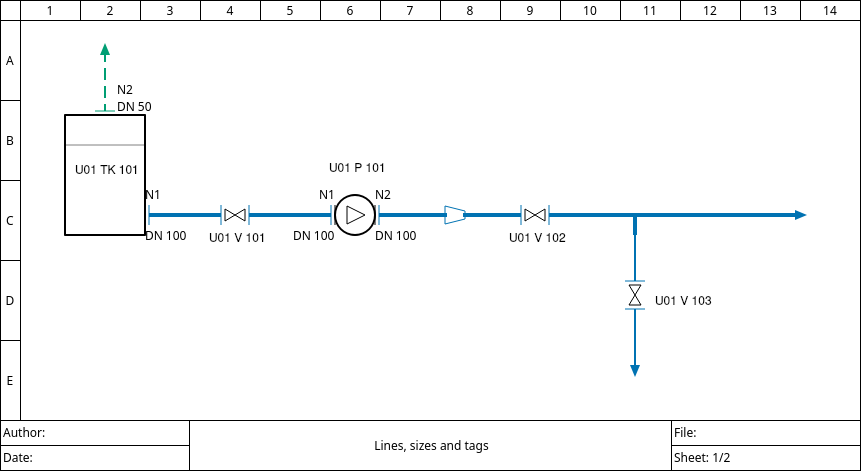
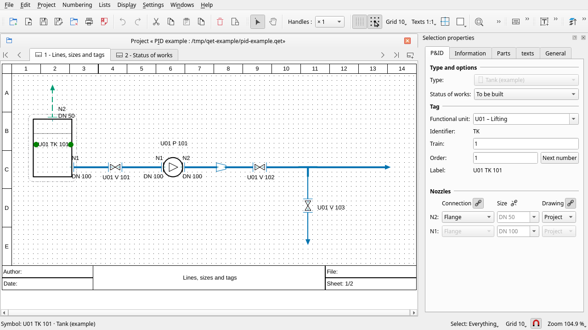

# QElectroTech for P&ID drawings (experimental fork)

This branch, `pipe-medium`, is a **personal and experimental fork** of
[QElectroTech](https://qelectrotech.org) that adds what is needed to draw
**P&IDs** (piping and instrumentation diagrams), for example for water
treatment plants.

**It is not official.** Nothing here has been reviewed or accepted by the
QElectroTech maintainers. The idea is discussed in
[Discussion #1475](https://github.com/qelectrotech/qelectrotech-source-mirror/discussions/1475).
This branch is a proof of concept; no pull request is proposed for now.

## The approach

Following the suggestion made in #1475, a pipe is **not a new kind of
object**: it is an ordinary QElectroTech conductor that carries a
**medium**. Terminals and conductors carry the same medium:

- `electrical` -- the default, not written in the files: every existing
  symbol and project is read and saved exactly as before;
- `pipe` -- the nozzles of process symbols and the pipes between them;
- `signal` -- the signal terminals of instruments and actuators and the
  signal lines between them.

There is no medium for a drive shaft: a motor is drawn in its symbol, and
a mechanical link would be a type of signal line.

So a pipe gets, for free, what a wire already has: drawing, routing,
selection, undo, copy and paste, saving in `.qet`, `.qetz` and `.qetdb`
files, the project database. What only makes sense for a wire is left out
of a pipe (see below).

The earlier attempt, with a separate pipe class, is kept frozen under the
tag `pipe-connector-freeze-2026-11-03`.

## A first look

The symbols of these pictures are simple shapes drawn for the example
only; the codes are invented.



*Lines colored after their fluid and drawn after their kind (main,
secondary, auxiliary), tags, names and sizes of the nozzles, flanges.*


*Status of works: existing and kept in grey, to be demolished in orange
(colors set for the project).*


*The page of a pipe: designation, drawing, other data.*



*The P&ID tab of a symbol: type and options, tag made of fields, nozzles.*


*Select by criteria: symbols by family, pipes by size, fluid, kind of
line.*

## What works today

**Terminals**
- A terminal of a symbol may connect the `pipe` or `signal`
  medium (attribute `medium` of `<terminal>` in the `.elmt`, written only
  when it is not electrical).
- Element editor: a *Medium* list in the terminal properties. The stem of a
  terminal takes the color of its medium; *Type* and *Potential* are
  hidden for a non-electrical terminal; its name follows its medium (N1,
  N2… for nozzles, S1… for signals).
- Joining two terminals of different media by hand is allowed but
  signalled (orange terminal, tooltip). A wiring rule, **off by default**,
  refuses it (*Refuse to join terminals of different media*, with the other
  conductors-per-terminal rules). Automatic wiring never joins two media.
- A nozzle takes **one** pipe: a branch is made with a tee symbol.
- **A junction** (a tee, a cross, an injection point: `pid_role` =
  `junction`) draws none of its lines. The folio draws one from the origin
  of the symbol to each nozzle, as the pipe of that nozzle: its width, its
  dashes, its colour. A nozzle without a pipe is drawn as the first pipe of
  the junction, else as a main line: a tee without its branch is printed
  too. The arrow head of an injection point, the only thing its symbol
  draws, takes the colour of the reagent line. In the collection, the
  thumbnail of a junction shows its lines.

**Pipes**
- Drawn by dragging from a nozzle, as a wire; released near a free nozzle
  of the same medium (20 pixels of the screen), the pipe is caught by it.
- **Draw a pipe** tool (key `P`, *Edit > Add*, the *Add* toolbar, the
  context menu of the folio): a click near a free nozzle starts a pipe, a
  second click or the release of a drag near another one ends it. A click
  never picks nor moves a symbol, the free nozzles are marked, the tool
  stays on after each pipe; right click or Esc cancels, then quits. The
  context menu of a symbol offers *Draw a pipe from here*: the pipe starts
  at its free nozzle nearest to the click. Lasso (Ctrl + drag) around two
  nozzles: one pipe between them.
- **From or to an empty place**: when the project names a symbol of free
  end (*P&ID* page, *Connections* tab), a click of the tool in an empty
  place starts or ends the pipe there, with that symbol at its end. The
  preview is the route the pipe will take; an end within 10° of an axis of
  the start is set on it (Ctrl: no snap), and Space switches between a
  route in L and in S when an end is free. A pipe started or ended on a
  free end takes that line up: one pipe, its route and data kept.
- **A tee placed by the tool**: when the project names a tee symbol, a
  click of the tool on a pipe, or a drag from a free nozzle released on
  it, places the tee there (on the grid, 2.5 mm at least from a nozzle),
  cuts that pipe and joins the branch, in one undo step.
- A conductor takes the medium
  of the terminal it starts from; other properties applied to it never
  change its medium. A file is read as it is: a conductor saved without a
  medium stays electrical.
- **No potential**: nothing goes from a pipe to the pipes or wires
  connected to it through the potential (numbering, shared properties,
  cables, bridges, search and replace…). What a line passes on has rules
  of its own (*Data that follow the line*, below).
- **No wire fields**: no wire number, no single-line symbols, definition
  mark, cable, wire color or section, voltage, bus or function.
- **Data of a pipe**: nominal diameter, fluid, material, flow, line
  number, piping class, nominal pressure, kind of line, spool, external
  finish, saved as `pid_…` attributes of the conductor, only those set.
  They go through `.qet`, `.qetz` and `.qetdb` files with no code of their
  own (checked by a round trip through a `.qetdb` file).
- **A page of its own** in the properties panel, and in the dialog a double
  click opens, in place of the page of a wire, in three sections
  (*Designation*, *Drawing*, *Other data*). Several pipes can be edited
  at once: only the field changed reaches them, in one undo step. The
  *Color* row tells where the color comes from (set by hand, status of
  works, automatic) and gives the automatic one back.
- **Data that follow the line**: a value set on the page of a pipe reaches
  its line in one undo step, and a message tells what was changed.
  Material, piping class and nominal pressure go through valves, tees and
  reducers, and stop at a **spec break** (a symbol of `pid_role` =
  `spec_break`) and at equipment. The fluid also goes through spec breaks;
  it stops at equipment and at a nozzle out of the run of a symbol (an
  injection point). The line number and the kind of line (main,
  secondary, auxiliary) go as the fluid, but through a tee or a cross only
  straight on, never into or out of the branch. The flow stops at every
  junction: a tee, a cross, an injection point. A new pipe takes what the
  line it joins has; the branch of a tee starts as a main line.
- **A codification per project**: *Project > Import a P&ID codification*
  reads the codes of the fluids and materials from a CSV file the company
  keeps (lines `kind;code;name;family`); none is shipped. The page of a pipe
  offers them ("W01 – Raw water"), a pipe keeps the code, free text stays
  possible. Saved in a `<pid_codification>` block, written only when there
  is one, in `.qet`, `.qetz` and `.qetdb` files.
  It is also edited in the *Codification* tab of the *P&ID* page of the
  project properties: fluids, materials and functional units in tables, a
  line added or removed, a CSV file imported or exported (codes, then
  colors and texts, for another project). A name changed touches no pipe; a
  code changed reaches the pipes and symbols bearing it in the same undo
  step; a code removed stays on them as free text, after a question; a code
  is unique in its list. The codes are kept in their natural order (W2
  before W10).
- **Colors set for the project**, in a *P&ID* page of the project properties
  or imported from the same CSV file (`fluid_color;family;#rrggbb`,
  `object_color;pipe;#rrggbb`). A pipe takes the color set on it, else that
  of the family of its fluid, else that of the pipes; a symbol takes that
  of its family of objects (`pid_family` attribute of the `.elmt`: only its
  ink changes, not the white that masks). The code knows no color of its
  own, what has none stays black, and a folio drawn without colors stays
  black too.
- **Defaults for new projects**: two buttons of the *P&ID* page,
  *Save as default codification* (codes of the fluids, materials and
  functional units, sizes of the materials, equal DN) and *Save as default
  presentation* (colors, texts, connections drawn, models of tags), saved
  apart. A new project starts from both; projects that already exist do
  not change.
- **A status of works** on pipes, signal lines and P&ID symbols: to be
  built, the default,
  existing and kept, to be demolished. Its color, set for the project,
  comes before any other. Chosen on the page of the object, or for a whole
  selection in its context menu, in one undo step. On a symbol it is kept
  with the options, so a `.qetdb` file refuses it as it refuses them.
- **Drawn after its kind of line** (ISO 10628-1): main line 1 mm (4 units),
  secondary 0.5 mm (2 units), auxiliary 0.5 mm dashed.
- A P&ID symbol placed or moved on a pipe always cuts it, whatever the
  button of automatic break of conductors says (wires and signal lines
  follow the button); a tee takes the pipe through its run and keeps its
  branch free.
- **Magnet of the nozzles**: a symbol placed or dragged with the mouse is
  caught (20 pixels of the screen; Shift: no magnet) by a free nozzle
  facing one of its own, by the free end of a pipe, which it takes, or by
  a connected nozzle when its own nozzle lies on that pipe. Two nozzles
  that touch get no pipe between them.
- **Deleting an in-line symbol** joins its two pipes into one again; the
  branch of a deleted tee goes with it. A free end left alone by a
  deletion is removed too.
- A pipe is picked over its drawn width, a little more when hovered.
- **Select by criteria…** (*Edit* menu, context menu of the folio): a
  window that stays open beside the folio, with a tree of boxes: symbols
  by family, symbol, functional unit or status; pipes by size, fluid,
  material, line number, piping class…; signal lines by type of signal or
  status. A branch appears only when an
  object bears the data, and has a *No size*, *No fluid*… box: the pipes
  without a size are found there. The search runs in the selection or in
  the whole folio and replaces, extends or reduces the selection;
  rectangles drawn on the folio while the window is open follow the same
  action.
- **Words**: a pipe and a signal line are never called conductors. The
  status bar names what the mouse points at (`Pipe W01-L · DN 100`,
  `Signal line: Pneumatic`), the undo captions count pipes and signal
  lines apart, and the labels that stand for wires, pipes and signal
  lines together say *lines and conductors* (selection filter,
  *Display > Show*, contexts of the shortcut bar). A wire is called a
  conductor as before.

**Signal lines**
- A conductor drawn between two signal terminals is a **signal line**. It
  is not a pipe (no size, fluid nor material) and not a wire (no number, no
  potential, no wire fields), even when the signal is an electrical one.
- **Type of signal**: undefined (the default), pneumatic, electrical,
  hydraulic, capillary, guided electromagnetic, data link
  (`pid_signal_type`, written only when chosen). It stays on its line: it
  is never passed on to the lines connected to it.
- **Drawn after its type**: a thin line (0.25 mm, 1 unit) in the color the
  project gives the signal lines (`object_color;signal;#rrggbb`), with the
  mark of its type repeated every 12 mm along each straight run, read from
  the bottom or from the right. The catalogue of eleven marks is fixed in
  the code (plain line, dashes, one to three oblique bars, the letter-like
  marks of the pneumatic, electrical and hydraulic signals, cross, wave,
  circle). **Which mark each type takes is set for the project** (*Signal
  lines* tab of the *P&ID* page, CSV line `signal_mark;type;mark`); by
  default the mark ISO 14617 gives the type, else that of ANSI/ISA-5.1.
- **Drawn with the tool of the pipes** (key `P`): a click near a signal
  terminal starts a signal line, a click near a signal terminal of another
  symbol ends it, with the same magnet. `T` (Shift + `T` backwards) turns
  the type of signal of the lines drawn; the preview shows its mark. The
  context menu of a symbol offers *Draw a signal line from here*. For now
  a signal line ends at a signal terminal only, and a signal terminal
  takes several lines.
- **Process connection** (the line from the process to an instrument
  bubble), drawn in one gesture with the same tool: from a signal terminal
  while the type is *Process connection*, to a free nozzle or a free end;
  or from a free nozzle or a free end to a signal terminal, whatever the
  type. On a free nozzle (equipment, valve, tee...) the line ends on the
  nozzle itself, which takes no pipe any more. A free end (the line ends on
  nothing) is closed by the **blind flange** set for the project (*P&ID*
  page, *Connections*, CSV line `tool_symbol;blind_flange;…`), placed where
  the free end was, and the line leaves from its signal terminal; the
  status bar says so when the line did not end with a flange. A blind
  flange placed this way goes with the pipe it closes; one placed by hand
  stays. One undo step.
- **Closures** (blind flange, dished end, cap: `pid_role="closure"`): the
  signal terminal of a closure takes one line, a process connection,
  whatever the type the tool draws or a drag gives; another type is
  refused there. A closure deleted alone leaves its line open again: the
  free end of the project where it was, the pipe and its data kept, its
  process connection gone with it (without a free end set, the pipe goes
  too, as before).
- **An end of a line turns by itself**: a symbol of the pipe family with
  one free nozzle (free end, arrow, vent, closure...) dropped or moved
  with its nozzle on a free end turns the same way and takes the line on;
  on a free nozzle of another symbol, it turns to face it, the two
  touching. Another symbol facing away from a free end is only placed:
  the line is never lost.
- **A page of its own** in the properties panel, and in the dialog a double
  click opens: type of signal and status of works, for one signal line or
  several, in one undo step.
- **Status of works** as on a pipe (`pid_status`): its color comes before
  that of the signal lines.
- A tee is never placed on a signal line: the tool says why.

**Sizes: the size lives on the pipe**
- The way of working: draw, connect, place the fittings, **size at the
  end**. The size belongs to the pipe; the valves and fittings on it follow.
- The **DN is the size of the line**, on every pipe (`pid_dn`). A material
  named by its outside diameter, as a plastic, also gives the pipe its
  outside diameter to the tenth (`pid_od`, Ø 110, Ø 88,9); the material
  chooses what is written on the drawing. Files always write a point; the
  project chooses the decimal separator shown (*P&ID* page, *Texts* tab),
  whatever the computer.
- Each material of the codification has its **list of sizes** (*Materials*
  tab, CSV line `size;M04;125;100`): an outside diameter and the DN of the
  flange it fits for a plastic, a DN (and an outside diameter if wanted)
  for a metal. When a DN has several outside diameters, one may be the
  default. **Equal DN** are set for the project (`dn_equal;60;65`): a cast
  iron DN 60 and a steel DN 65 are the same size; without a material, such
  a size is written `DN 60/65`.
- The page of a pipe has one size field: a DN or an outside diameter is
  typed, the other is found in the list of its material, with a question
  when there are several (its answer can be kept as the default). When the
  material changes, the DN is kept and the outside diameter found again. A
  size out of the list of its material is marked by an orange band under
  the pipe, on screen only.
- **Inline symbols have no size of their own**: the nozzles of a valve
  (`pid_inline`, its two nozzles) or of a tee (`pid_run="N1 N2 N3"`)
  follow their pipe; their size field is greyed, in
  the *Nozzles* section of the *P&ID* tab as in the element editor. A
  change made on the page of a pipe goes through them, and through
  nozzles that touch with no pipe between them, in one undo step, each
  material taking it as it has it (DN 60 for a cast iron). It stops at
  equipment and at reducers.
- **The branch of a tee has a size of its own**: the size goes through a
  tee or a cross straight on only, as the line number. A reducing tee is
  one tee, DN 25 on a DN 50 line, with no reducer and no mark; a change of
  DN on the line leaves its branches as they are. A pipe drawn from the
  branch starts with the size of the line (an equal tee until told
  otherwise), unless the nozzle at its other end has a size.
- Equipment, instruments and **reducers** have sizes of their own: given in
  the symbol (the element editor chooses DN or Ø beside the field) and
  changed on a placed symbol in the *Nozzles* section of its *P&ID* tab
  (`<pid_nozzles>` block of `<element>`, written only when set; undoable).
  A reducer (`pid_role` = `reducer`) is where the size of the line
  changes: a size typed on one of its sides resizes that line in the same
  undo step. A `.qetdb` file refuses a size given on a placed symbol, as
  it refuses the options.
- A size fills what is empty and never replaces a value: a new pipe
  without a size takes that of its nozzle, once. A size typed on a nozzle
  of an equipment, or brought by *Change type*, fills the pipes without a
  size of its line, up to a reducer, an equipment or a sized pipe, in one
  undo step.
- A difference is marked without being blocked: an orange diamond in front
  of the pipe, on screen only, and a tooltip (a reducer with the same size
  on both sides too). No reducer is ever inserted.
- A reducer may name its large side (`pid_large`, *Large side* list of the
  element editor): laid the wrong way, its two nozzles are marked and the
  tooltip says so; nothing is turned nor blocked.
- The size of a nozzle is shown with its name, when terminal names are
  shown and the project shows the sizes; the word `DN` can be left out
  (*Texts* tab). Both are written 1 mm from the end of the nozzle, along its
  pipe and clear of the mark of its connection: the name above and the
  size below a horizontal pipe, their letters 3 mm from its axis; beside
  a vertical one, upright or turned
  as the project keeps the texts of rotated elements horizontal or not.

**Connections of the nozzles**
- Each nozzle has a kind of connection: flange (the default, not written),
  plain end, socket (to glue, to weld or with a gasket: the material of the
  pipe tells them apart), pipe thread, butt weld, grooved or quick coupling
  (`pid_connection` attribute of `<terminal>` in the
  `.elmt`, changed on a placed symbol in the *Nozzles* section of its
  *P&ID* tab, in the same undo step as its size). The list is fixed in the
  code.
- In that section the nozzles are listed by name (N10 after N9), and a
  chain button above each column (connection, size, drawing of the
  connection) keeps the nozzles of the symbol alike: the first one gives
  its value. A link is undone only by a click, and stays
  undone (`same_connection`, `same_size`, `same_mark` = `false` on
  `<pid_nozzles>`).
- The connection limits the kind of size: a flange or a quick coupling
  takes a DN, a pipe thread inches, the others a DN or an outside diameter.
  When the connection changes, a size it allows is kept, else it is
  converted when there is one answer, else it is removed and said.
- A pipe thread is sized in inches (`pid_thread="1 1/2"`), shown `G 1"1/2`,
  and typed as `G 1"1/2`, `1"1/2`, `3/4"` or `1-1/2`. A fixed table (the
  usual one of EN 10255, 1/8" = DN 6 to 6" = DN 150, shown in the
  *Connections* tab of the *P&ID* page) joins inches to DN:
  for the orange diamond, and for a new pipe, which takes the DN of its
  threaded nozzle (a pipe is never sized in inches).
- The folio shows the size (`DN 100`, `Ø 110`, `G 1"1/2`) and draws the
  connection at the end of the nozzle (flange, socket…), for the kinds of
  connections and the families of symbols the project chooses
  (*Connections* tab); the connection is also named in the tooltip of the
  nozzle.
- How it is drawn: a flange is a line across the pipe, 1 mm from the side
  of a valve or at the end of the nozzle of an equipment. The pipe brings
  its own part, in its own color: its flange 1 mm further (the
  counter-flange), its socket around a plain end (drawn with the
  sockets), its grooved end in the collar, the other half of a quick
  coupling. A butt weld is a dot. Two symbols joined nozzle to nozzle
  draw nothing between them. A spec break is transparent: the pipe draws
  the part that answers the symbol on the other side. A pipe begins at
  its nozzle: the square end of a thick line never shows behind it, in
  the symbol. The element editor draws the mark of the connection chosen
  on the nozzle, in the colour of the nozzle.

**Symbols**
- **A *P&ID* tab** in the properties panel of a placed P&ID symbol, first
  and open by default, in sections: *Type and options*, *Tag*, *Nozzles*,
  each shown when it applies. An electrical symbol has no such tab.
- **Change type**: right-click a placed symbol, *Change type* lists the
  symbols of the same collection folder that have the same size, hotspot
  and terminals (name, place and medium), and through which the lines go
  the same way: the same run, a reducer for a reducer, a spec break for a
  spec break. A tee, whose branch is of the line, is never offered for an
  injection point, whose reagent is not. The symbol is swapped in place,
  keeping its position, information and connections; undoable. A generic
  symbol (a valve, a pump) can be placed first and made precise later. A
  P&ID symbol keeps its texts (its tag) and takes the identifier of the new
  symbol. The *Type* list of the *P&ID* tab does the same; both show a
  thumbnail of each symbol.
- **Symbols that play a role for the lines** (`pid_role`, chosen in the
  *Piping* block of the element editor, with the family, the run and the
  large side): a reducer, a free end, a spec break, a junction. An end closure (blind
  flange, cap) needs none: a symbol of the `pipe` family with one nozzle
  takes the free end of a line and follows its size.
- **Tags made of fields**: a P&ID symbol may give the identifier of its
  type (`prefix` attribute of `<definition>`, e.g. `PC`). A placed
  equipment or valve has a *Tag* section in its *P&ID* tab: functional
  unit (picked in the list of the project, or typed), train and order,
  saved as information of the element. The model of its family in the
  project, for instance `{unit} {id} {train}{order:2}`, makes its label
  (`U01 PC 105`); `\n`
  starts a new line, for the three lines of an instrument bubble. The label
  follows a change of model or of type, and a label held twice in the
  project is told. Without a model, the label is typed by hand as before.
  The functional units come with the codification of the project (CSV line
  `unit;U01;Lifting`), the models with its presentation (CSV line
  `tag_model;equipment;...`).
- **Letters of an instrument**: an instrument bubble may be any instrument,
  so its *Tag* section asks its letters of identification (`PT`, `LIC`),
  typed in capitals, instead of the identifier of its symbol; they take the
  place of `{id}` in the model. The letters the project uses are offered
  while they are typed: a list of the codification, *Instrument letters*
  (CSV line `letters;PT;Pressure transmitter`), a help only.
- **Tags numbered automatically**: the order is one more than the highest
  held by the same functional unit, identifier and train in the project
  (a number freed below it is not given again; no counter is saved, the
  project is read each time). The *Tag* section fills an empty order as soon
  as the unit is there, and *Next number* gives it on demand; an order
  typed is never changed. When the model shows the train, a numbered tag
  always has one (0 for none). A pasted copy whose tag is taken gets the
  next order (a cut and paste keeps its own).
  Instruments are numbered by loop, as ANSI/ISA-5.1 (annex A) does: in
  series by default, one sequence for all of them whatever their letters
  (PT 105 and PIC 105 are the loop 105); in parallel when the presentation
  says so (`tag_option;instrument_numbering;parallel`), one sequence for
  each measured variable, their first letter. A loop copied whole gets one
  new number. Equipment and valves keep a sequence of their own.
- **Create similar**: right-click a placed symbol, *Create similar* starts
  the usual placement mode with the same symbol, options, status of works
  and rotation. Device information is not copied; a P&ID tag takes the
  same functional unit and train, and the next order at each drop.
  Automatic connections apply as usual.
- **Ends and corners of lines**: the element editor can draw the ends of a
  line round or flat and its corners round, mitred or bevelled (`line-cap`
  and `line-join` in the style of a part; nothing written for the default).
- **Symbols with options**: a symbol may declare options (an `<options>`
  block, each option with named values and a default) and draw some parts
  only for some values (`show_if` attribute). Example: one pump symbol
  with a *motor* option (none, fixed speed, variable speed) instead of
  three symbols. A terminal may depend on the options too: the signal
  terminal of a valve is shown, and takes a signal line, for an automatic
  actuator only; it stays a terminal of the symbol (*Change type* keeps
  it), and a line already connected to it stays. A placed symbol saves its choices in its `<element>`
  block, only when it has some; they are chosen in the *Type and options*
  section of its *P&ID* tab or in the *Options* submenu of its context
  menu (undoable) and kept by *Change type*. A `.qetdb` file
  does not keep them yet: saving such a project as `.qetdb` is refused
  with a message.

**Scale and paper sizes**
- P&ID drawings use 4 drawing units per millimetre, close to the 3.78 of
  the PDF export. Choose the paper size in the *Format* list of the folio
  properties (A0 to A3 suit a P&ID): widths and symbols come out at about
  106 % of their nominal size, and a P&ID is not drawn to scale anyway. The
  default of a new folio is set in the project properties, *New sheet*.
- The *P&ID* page of the project properties sets the size of the tags of
  equipment, valves and instruments and of the names and diameters of the
  nozzles (none set: the size of the symbol), and whether those of the
  nozzles are printed and exported.

**Checks**: every step has its tests, and the example projects of
QElectroTech are saved byte for byte as by master.

## What is missing

- The line designation shown along a pipe.
- Flow direction, crossings as ISO 10628-1 draws them.
- A signal line from or to a pipe or an empty place (the tap of an
  instrument), the texts of a bubble one by line, equipment data tables.
- Piping classes (material, pressure, wall thickness), the pressure rating
  (PN) of the nozzles.
- Equipment drawn to size (a tank that stretches).
- Keeping the tags of an issued drawing set: once issued, a deleted tag
  should never be given again.
- Declaring options and conditions in the element editor (they are written
  by hand or by script for now, and kept by the editor).
- A library of P&ID symbols (symbols are drawn *inspired by* ISO 10628-2,
  never copied from it; none is published here).

## What the files carry

Every P&ID addition is written only when it is set, so a file without one
is saved as by master. A name added for the P&ID starts with `pid_`; what
is inside a `pid_` block keeps short names. `medium` keeps its name, and
the additions that are not P&ID-only keep plain names (`prefix`,
`<options>`, `show_if`, `line-cap` / `line-join`). Booleans are `true` /
`false`.

| Where | Name | Values | Default | Written when |
|---|---|---|---|---|
| `.elmt`, `<definition>` | `pid_family` | `equipment`, `valve`, `instrument`, `pipe` | none: not a P&ID symbol | the symbol has a family |
| `.elmt`, `<definition>` | `pid_inline` | `true` | a line does not run through it | a line runs through its two nozzles (valve) |
| `.elmt`, `<definition>` | `pid_run` | names of nozzles, space separated (`N1 N2 N3`) | the two nozzles of a `pid_inline` symbol | a tee or a three-way valve |
| `.elmt`, `<definition>` | `pid_role` | `reducer`, `free_end`, `spec_break`, `junction`, `closure` | none | the symbol plays that role for the lines |
| `.elmt`, `<definition>` | `pid_large` | name of a nozzle (`N1`) | none: the way of the reducer is not checked | a reducer names its large side; a large side smaller than the other one is marked |
| `.elmt`, `<definition>` | `prefix` | identifier of the tag (`PC`) | that of the collection folder | the symbol gives one |
| `.elmt`, `<definition>` | `<options>` block | options, each with named values and a default | no option | the symbol declares options |
| `.elmt`, a part | `show_if` | `option=value,value`, conditions separated by `;` | always drawn | the part belongs to some values |
| `.elmt`, a part | `line-cap`, `line-join` in `style` | `round`, `flat` / `miter`, `round`, `bevel` | square ends, default corners | not the default |
| `.elmt`, `<terminal>` | `medium` | `pipe`, `signal` | `electrical` | not electrical |
| `.elmt`, `<terminal>` | `show_if` | as for a part | always shown, takes lines | the terminal belongs to some values |
| `.elmt`, `<terminal>` | `pid_dn`, `pid_od`, `pid_thread` | DN; outside diameter to the tenth; inches (`1 1/2`) | the size of its pipe | a nozzle with a size of its own |
| `.elmt`, `<terminal>` | `pid_connection` | `plain_end`, `socket`, `thread`, `butt_weld`, `grooved`, `quick_coupling` | `flange` | not a flange |
| `.qet`, `<element>` | `<options>` block | `<option name="…" value="…"/>`, among them `pid_status` (`existing`, `demolished`) | the default of each option; to be built | a value is chosen |
| `.qet`, `<element>` | `<pid_nozzles>` block | `<nozzle name dn od thread connection mark/>`, `mark` = `always`, `never`; on the block, `same_connection`, `same_size`, `same_mark` = `false` | those of the symbol and the project; nozzles linked | a nozzle of the placed symbol is changed, or a link undone |
| `.qet`, `<element>` | information `pid_unit`, `pid_train`, `pid_order` | text | empty | the *Tag* section is filled |
| `.qet`, `<element>` | information `pid_letters` | letters of identification of an instrument (`PT`) | the identifier of its symbol | the letters of an instrument are typed |
| `.qet`, `<element>` | `pid_tool_placed` | `true` | `false`: placed by the user | a blind flange the pipe tool placed on a free end; it goes with the pipe it closes |
| `.qet`, `<conductor>` | `medium` | `pipe`, `signal` | `electrical` | not electrical |
| `.qet`, `<conductor>` | `pid_dn`, `pid_od` | DN; outside diameter to the tenth | none | set |
| `.qet`, `<conductor>` | `pid_fluid`, `pid_material`, `pid_flow`, `pid_line_number`, `pid_piping_class`, `pid_nominal_pressure`, `pid_spool`, `pid_external_finish` | text (a code of the codification, or free) | empty | set |
| `.qet`, `<conductor>` | `pid_line_kind` | `secondary`, `auxiliary` | `main` | not main |
| `.qet`, `<conductor>` | `pid_color` | `#rrggbb` | the color of the codification | set by hand |
| `.qet`, `<conductor>` | `pid_status` | `existing`, `demolished` | to be built | a pipe or a signal line not to be built |
| `.qet`, `<conductor>` | `pid_signal_type` | `pneumatic`, `electrical`, `hydraulic`, `capillary`, `guided_electromagnetic`, `data_link`, `process_connection` | undefined | a signal line whose type is chosen |
| `.qet`, `<project>` | `<pid_codification>` block | fluids, materials and their sizes, functional units, instrument letters (`<instrument_letters code name/>`), equal DN, tag models, colors, text sizes, text options | none | the project has a codification |
| `.qet`, `<pid_codification>` | `instrument_numbering` | `parallel` | in series | the loops of the instruments are numbered in parallel |
| `.qet`, `<pid_codification>` | `<tool_symbol role location/>` | `role` = `free_end`, `tee` or `blind_flange`; `location` a symbol of a collection (`custom://…`) | none: the pipe tool needs a nozzle, a click on a pipe places no tee, a process connection is not drawn to a free end | a symbol is chosen for the role |
| `.qet`, `<pid_codification>` | `<signal_mark type mark/>` | `type` = a type of signal (`undefined` and those of `pid_signal_type`); `mark` = `none`, `dashes`, `bar1`, `bar2`, `bar3`, `a_mark`, `e_mark`, `l_mark`, `cross`, `wave`, `circle` | the mark of ISO 14617 for the type, else that of ANSI/ISA-5.1 | the project gives the type another mark than the default one |

A `medium` this version does not know is read as electrical and said in the
log.

## Read this before using it on real work

- The file format of these additions may change.
- The official QElectroTech opens a project of this fork, but shows a pipe
  as a wire and drops what it does not know when it saves it.

## Trying it

Build the branch as QElectroTech itself, following [INSTALL.md](INSTALL.md).
On Debian with Qt 6 and the KDE Frameworks of the system:

```bash
git clone https://github.com/Opus-id/qelectrotech-source-mirror.git
cd qelectrotech-source-mirror
git checkout pipe-medium
git submodule update --init --recursive
mkdir build && cd build
cmake .. -G Ninja -DCMAKE_BUILD_TYPE=Release -DBUILD_WITH_KF=ON -DBUILD_KF=OFF
cmake --build . --parallel
./qelectrotech
```

Then make a test symbol with two nozzles: in the element editor, add two
terminals and set their *Medium* to *Pipe (nozzle)*. Place two of them on a
folio and drag from a nozzle to the other.

## Licence

Same as QElectroTech: GNU GPL, version 2 or later (see `LICENSE`).
